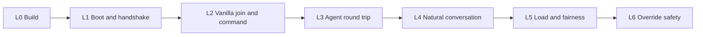

# Worldspeaker validation scenarios

## Purpose

This document defines the end-to-end scenarios whose passing **predicts a
working mod**: a player on a vanilla client can talk to the configured
character and receive a real, attributed agent answer, while failures stay
safe and private. It complements, and does not replace, the story acceptance
criteria and the cross-epic coverage table in the
[specification](specification.md#acceptance-scenario-coverage).

Each scenario states its preconditions, stimulus, required observations, and
failure signals in terms a tester can check without reading source code. A
scenario passes only when **every** "Then" observation is recorded.

## Evidence profiles

A result is only as strong as the profile it ran in. Always record the profile.

| Profile | Environment | What a pass means |
| --- | --- | --- |
| P0 — Offline | Unit, contract, and fixture tests on any developer machine. | Logic is internally consistent. Predicts nothing about Fabric transformation, real packets, or OpenClaw. |
| P1 — Local-dev live | Real Fabric 1.21.1 dedicated server, offline mode, headless or real client, `WORLDSPEAKER_LOCAL_DEVELOPMENT=true`, companion fixture **or** real OpenClaw host. | Real packet ingress, mixins, command dispatch, handshake, and chat publication work. Predicts a working mod. **Never** qualification evidence. |
| P2 — Candidate | Pinned platform from [compatibility](compatibility.md), online mode, real accounts, real OpenClaw host, no local-dev override, separate authorization. | Qualification evidence for COMPAT-01 and the stories traced below. |

Rules:

- A P1 run with the companion **fixture** proves the Minecraft side only. Any
  scenario that requires an agent answer must name the OpenClaw host version
  and provider used; a fixture result for those scenarios is recorded as
  `NOT RUN`, not `PASS`.
- The local-dev override relaxes exactly two checks: the Java vendor/build
  match and the online-mode authentication requirement. It must not relax
  binding, credential, manifest, permission-grant, or audience checks.
- Record outcomes as `PASS`, `FAIL`, `BLOCKED` (prerequisite missing), or
  `NOT RUN`. Never report a blocked or fixture-substituted scenario as passed.

## Definition of "working"

The mod is predicted to work when **VS-01 through VS-12 pass in P1 with a real
OpenClaw host**. It is qualified only when the same set, plus the P2-only
scenarios, pass in P2. Scenarios VS-13 through VS-20 are required for the full
promised experience but do not block the basic prediction.

## Scenario ladder

Run levels in order. A failure at one level makes higher levels uninformative.

### L0 — Build

#### VS-00 — Build and offline suites are green

- **Given** a clean checkout and the documented toolchain.
- **When** the [verification procedure](NEXT-ITERATION.md#verification-procedure)
  runs: Gradle `check`, companion `typecheck` and `test`, and tooling tests.
- **Then** every command exits 0, and `remapJar` produces one mod JAR whose
  SHA-256 is recorded for the run.
- **Fail signals:** any non-zero exit; a flaky test that passes only on rerun is
  recorded as a failure with its name.
- **Stories:** DIST-03.

### L1 — Boot and handshake

#### VS-01 — Mod loads server-only

- **Given** the VS-00 JAR in the server `mods/` directory with the exact Fabric
  Loader and Fabric API versions.
- **When** the server starts.
- **Then** the server log contains the Worldspeaker load line, the server
  reaches `Done`, and the mod list shows `worldspeaker` with no mixin or
  entrypoint error.
- **Fail signals:** mixin apply failure, missing refmap target, crash, or a
  load line reporting a compatibility code other than the expected one.
- **Stories:** COMPAT-01, COMPAT-02.

#### VS-02 — Incompatibility fails closed with a private diagnostic

- **Given** each of: a malformed `startup-config.json`, a missing credential
  file, and (without the local-dev override) a mismatched Java build.
- **When** the server starts and an allowed player runs `/worldspeaker ask hi`.
- **Then** the server log shows the specific `WS-COMPAT-*` reason code, the
  companion is never contacted, and the player receives only the safe
  unavailable notice within 1,000 ms. No diagnostic text appears in chat.
- **Fail signals:** a generic stack trace without a reason code; companion
  traffic; a local acknowledgement implying admitted work.
- **Stories:** COMPAT-01, CHAR-03, RESP-03, CHAT-01.

#### VS-03 — Companion handshake reaches ready

- **Given** a companion configured with the same startup bundle and credential.
- **When** the server starts, and again after a server restart.
- **Then** the companion log records `ready` with protocol
  `worldspeaker.compat.v5`, and the peer serial increments by exactly one per
  server start.
- **Fail signals:** socket close codes `4001`–`4099`, `EADDRINUSE`, repeated
  `ready` without a restart (duplicate peers), or no `ready` within 15 s.
- **Stories:** INT-02, INT-03.

#### VS-04 — Handshake rejects wrong identity

- **Given** in turn: a wrong credential, a wrong `manifestSha256`, and a
  different `binding.characterId` on the companion side.
- **When** the server starts.
- **Then** no `ready` is logged, the server records a private rejection reason,
  and `/worldspeaker ask` yields the safe unavailable notice.
- **Fail signals:** any `ready` event; any player-visible diagnostic detail.
- **Stories:** INT-02, CHAT-04.

### L2 — Vanilla join and explicit command

#### VS-05 — Vanilla client joins without Worldspeaker installed

- **Given** an unmodified 1.21.1 client (or a headless client meeting the
  [harness requirements](#headless-client-harness)).
- **When** it joins.
- **Then** it spawns, the server logs the join, and Worldspeaker registers no
  custom payload channel, resource pack, or client-required content.
- **Fail signals:** disconnect during configuration or play; a server request
  for a Worldspeaker resource pack or channel.
- **Stories:** COMPAT-02.

#### VS-06 — Help is discoverable

- **When** the player runs `/worldspeaker help`.
- **Then** the player alone receives one system line naming the configured
  character display name and the `/worldspeaker ask <text>` usage.
- **Fail signals:** no reply; reply broadcast to other players; reply naming a
  hard-coded character.
- **Stories:** CONV-01.

#### VS-07 — Allowed player gets a truthful first reply within 1,000 ms

- **Given** the player's UUID is in `conversationAllowedPlayers` and VS-03 passed.
- **When** the player runs `/worldspeaker ask <text>`.
- **Then**, all of:
  1. The player receives exactly one first reply within 1,000 ms of server
     receipt (`t0` to `t1` per the [latency contract](specification.md#latency-and-responsiveness)),
     and the recorded source is either `OPENCLAW` or `LOCAL_ACK`.
  2. A local acknowledgement renders the configured template with the
     player's name and does not claim the work is solved or approved.
  3. The companion logs one `request` with the same player UUID, `inputKind`
     `command`, and the current `abilityPolicyRevision`.
  4. No other online player receives the reply.
- **Fail signals:** missing or duplicate first reply; latency above 1,000 ms;
  a companion request whose player UUID differs from the sender.
- **Stories:** RESP-01, CONV-01, CONV-04.

#### VS-08 — Ungranted player is refused

- **Given** a player not in `conversationAllowedPlayers`.
- **When** that player runs `/worldspeaker ask <text>`.
- **Then** that player receives the "not authorized" notice within 1,000 ms and
  the companion logs no `request`.
- **Stories:** ABIL-03, RESP-03.

#### VS-09 — Non-player and redirected sources are refused

- **When** `/worldspeaker ask hi` runs from the console, RCON, a function, and
  `execute as <allowed player> run worldspeaker ask hi` issued by another source.
- **Then** each is refused as unauthenticated, no companion `request` is
  logged, and no reply reaches the impersonated player.
- **Stories:** CONV-01, CHAT-04.

### L3 — Agent round trip

#### VS-10 — A real agent answer reaches only the requester

- **Given** a real OpenClaw host (record version and provider) bound to the same
  character; the fixture does not satisfy this scenario.
- **When** an allowed player asks a simple question.
- **Then** the player receives a terminal, character-consistent answer that
  addresses the question; the answer source is recorded as `OPENCLAW`; no
  acknowledgement follows the answer; and no other player receives it.
  Completion latency is recorded toward the 5 s median / 10 s p95 target.
- **Fail signals:** acknowledgement-only exchange; answer to the wrong player;
  raw tool output, reasoning, or diagnostics in chat.
- **Stories:** CONV-06, RESP-02, CHAT-02, INT-01.

#### VS-11 — Companion outage and recovery

- **When** the companion stops while the server runs, a player asks, then the
  companion restarts.
- **Then** during the outage the player gets the safe unavailable notice within
  1,000 ms (not an acknowledgement); after restart a new `ready` appears and a
  new request succeeds; no request from the outage is replayed.
- **Stories:** RESP-03, INT-04.

#### VS-12 — Departure cancels in-flight work

- **When** a player asks and disconnects before the answer.
- **Then** the companion logs `cancel` for that request ID, and nothing is
  published to that player or anyone else after the disconnect.
- **Stories:** RESP-05.

### L4 — Natural conversation

#### VS-13 — Natural addressing and third-party mentions

- **When** an allowed player chats with the display name or an alias at the
  beginning, middle, and end of a sentence; then begins a line with another
  online player's name or `@name` while mentioning the character.
- **Then** the first three each produce one request and first reply; the
  fourth produces no request.
- **Stories:** CONV-02.

#### VS-14 — Follow-up window is bounded and attributed

- **When** after an answered exchange the same player chats without the name
  within 30 s, after 30 s, and after `/worldspeaker end`; and a second player
  chats without the name inside the first player's window.
- **Then** only the first in-window line is routed; the others are not.
- **Stories:** CONV-03.

### L5 — Load and fairness

#### VS-15 — Repetition does not starve another player

- **When** player A sends one identical request seven times in six seconds and
  player B sends one distinct request during that burst.
- **Then** B receives a first reply within 1,000 ms and a useful answer; A's
  repeats coalesce or are refused visibly; no more than one agent turn runs
  for A's identical text.
- **Stories:** RESP-04, OPS-02.

#### VS-16 — Long work stays honest

- **When** a request remains unanswered past 10 s.
- **Then** truthful progress appears per the documented interval, and a
  terminal answer or timeout notice arrives within the execution budget.
- **Stories:** RESP-02.

#### VS-17 — Tick health under traffic and outage

- **When** VS-15 traffic runs, and again with the companion stopped.
- **Then** recorded tick-time distribution stays within the idle baseline
  envelope defined in COMPAT-03 evidence; no queue grows without bound.
- **Stories:** COMPAT-03.

### L6 — Override and privacy safety

#### VS-18 — The local-dev override is visible and never qualifies

- **When** the server or companion starts with the override enabled.
- **Then** each logs one private startup warning naming the relaxed checks; any
  qualification report generated from that run is marked P1; a candidate or
  release build refuses to honor the override.
- **Stories:** COMPAT-01, DIST-03.

#### VS-19 — Online mode still enforces authentication

- **Given** P2 conditions (online mode, override absent).
- **When** VS-07 through VS-09 rerun with real accounts.
- **Then** results match P1, and an offline-mode server without the override
  refuses every player as unauthenticated.
- **Stories:** COMPAT-02, CONV-01.

#### VS-20 — Logs carry no conversation bodies or secrets

- **When** VS-07, VS-10, and VS-11 have run.
- **Then** server and companion logs contain request IDs, player UUIDs, and
  event kinds, but no chat body, credential, or provider key.
- **Stories:** OPS-01, OPS-05.

## Headless client harness

Headless clients are acceptable for P1 and for automated regression. They must
meet these protocol requirements for 1.21.1, or the run is invalid:

1. Reply to configuration-phase `ping` with `pong` before entering play.
2. Send commands with the `chat_command` packet and no leading `/`. Plain chat
   packets beginning with `/` are dropped by vanilla.
3. Unsigned clients require `enforce-secure-profile=false` and therefore an
   offline-mode server, which in turn requires the local-dev override (P1 only).
4. Let the protocol library finish configuration; a duplicate
   `finish_configuration` corrupts play-state decoding.
5. Decode-only library errors that do not disconnect the client (for example a
   registry `PartialReadError`) are recorded but do not fail the scenario.

The harness must record, per scenario: client library and version, player name
and UUID, server receipt and client display timestamps where available, every
system chat line received, and the companion event sequence.

## Current results

| Scenario | Profile | Result | Note |
| --- | --- | --- | --- |
| VS-00 | P0 | PASS | Java and companion suites green on 2026-11-05; one Java test passed only on rerun and must be recorded as flaky. |
| VS-01 | P1 | PASS | Server reached `Done`; load line present. |
| VS-03 | P1 | PASS | `ready` on v5; peer serial increments per restart. |
| VS-05 | P1 | PASS | Headless client spawned. |
| VS-06 | P1 | PASS | Help named the configured character. |
| VS-07 | P1 | PARTIAL | Local acknowledgement and companion `request` observed; latency not measured. |
| VS-10 | P1 | NOT RUN | Companion was the test fixture, not an OpenClaw host. No agent answer has been observed. |
| VS-12 | P1 | PARTIAL | `cancel` observed after disconnect; absence of late publication not checked. |
| VS-18 | P1 | FAIL | Override is honored in any build and logs no warning. |
| All others | — | NOT RUN | — |

